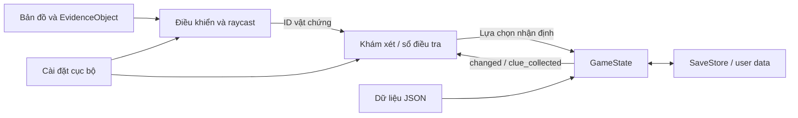

# Kiến trúc và lộ trình sau prototype

## Ranh giới hệ thống đang có

`main.tscn` là composition root: dựng bản đồ, gắn người chơi, UI và âm thanh. `Investigator` chỉ phát yêu cầu tương tác với một ID; `EvidenceObject` không sửa hồ sơ. UI trình bày dữ liệu và chuyển lựa chọn sang `GameState`. `GameState` xác thực ID/quan sát, ghi nhận một lần, phát signal và đánh giá lời giải; save store xử lý I/O riêng. Cài đặt âm thanh/đồ họa không nằm trong tiến độ vụ án.

Dữ liệu vụ án có schema được kiểm tra khi tải. Lời giải cố định; không chọn hung thủ ngẫu nhiên. Timeline ban đầu chứa thông tin chưa xác minh để người chơi đối chiếu; không phải đáp án tự động. Việc nộp kết luận sai vẫn cho phép tiếp tục điều tra. Chỉ lưu dữ liệu hợp lệ và chỉ thay trạng thái sau khi đọc/kiểm tra thành công.

## Giai đoạn 2: multiplayer thực, chưa triển khai

Giữ các ID ổn định. Thay đầu vào lệnh cục bộ bằng một lớp `SessionTransport`, gửi yêu cầu `inspect/collect/conclude` tới server có thẩm quyền. Server nắm trạng thái vụ án, quyền nghề, khoảng cách tương tác và thứ tự revision; client chỉ trình bày snapshot/delta đã được chấp nhận. Không tin `collector`, timestamp hay vị trí do client tự khai. Không dùng việc client đang có JSON lời giải làm ranh giới bảo mật; chuyển lời giải và đánh giá sang server nếu cần chống gian lận.

Triển khai dự kiến: Godot headless server ENet/UDP trên VPS có cổng công khai, tối đa 3 người/phòng, room service HTTPS cấp mã phòng ngắn và phiên reconnect riêng. Mã phòng không thay thế token phiên. Không dùng máy host sau NAT như thể mọi người đều có thể truy cập. Cần tài liệu server, quản lý thời hạn phòng và kiểm thử hai mạng Internet độc lập trước khi tuyên bố online hoạt động.

Kiểm thử bắt buộc ở giai đoạn đó: ba process thật; tạo/tham gia/ready; người thứ tư bị từ chối; đồng thời lấy cùng vật chứng không nhân đôi; mất gói/kết nối lại; snapshot sau ngắt mạng; bỏ phiếu và chỉ host bắt đầu; quyền của từng nghề; hoàn thành với hai người qua trạm kỹ năng phụ. Bản hiện tại không đăng ký RPC hay giả lập các kiểm thử này.

## Giai đoạn 3–4: vai trò, đồng đội và vụ án đầy đủ

Ba nghề dùng capability IDs thay vì hardcode người chơi 1/2/3. Với hai người, trạm hỗ trợ cung cấp kỹ năng thiếu mà không tạo khóa tiến trình. Chế độ solo sau này có hai đồng đội AI chạy offline: hàng đợi công việc, finite state machine (nhận việc → di chuyển → phân tích → báo cáo), trạng thái nhiệm vụ tuần tự hóa. Tính cách thể hiện qua nhịp làm việc và lời thoại, không làm hỏng chứng cứ. Bạn bè tiếp quản một slot nghề cùng trạng thái nhiệm vụ, không xóa báo cáo đang làm. Đây là thiết kế cho bước sau, chưa có hành vi AI trong prototype.

Mở rộng bệnh viện đủ tám khu vực, dựng NPC 3D và hội thoại phân nhánh, minigame pháp y, UV/camera, timeline kéo-thả và bảng suy luận. Mỗi cơ chế cần kiểm thử riêng trước khi gọi vụ án hoàn chỉnh. Đo thời lượng thực qua playtest; không kéo dài câu đố bằng chờ cưỡng bức để đạt 30 phút.

## Giai đoạn 5–6: tài sản, hiệu năng và phát hành

Thay mẫu hình học qua [quy trình Blender/glTF](ASSETS.md), bake ánh sáng khi renderer đích hỗ trợ đường đi đã chọn, atlas vật liệu, LOD thực cho mesh nhập, tải từng vùng và đo draw calls. Duy trì tiếng Việt và lựa chọn đồ họa hiện có. Windows EXE của prototype là sản phẩm thử nghiệm, không đồng nghĩa giai đoạn đồ họa/phát hành đã hoàn thành. Bắt buộc QA Windows 10/11 và laptop i5-U/Intel UHD 8 GB trước phát hành.
